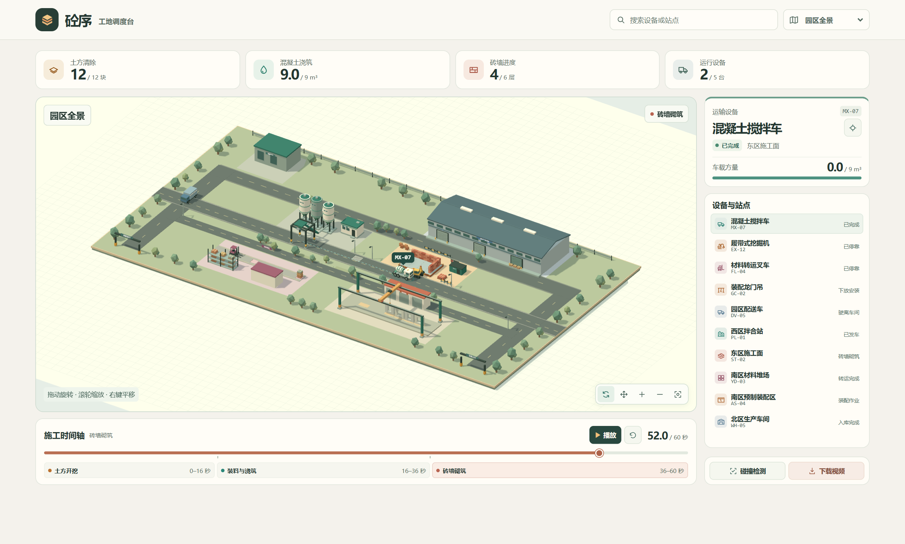
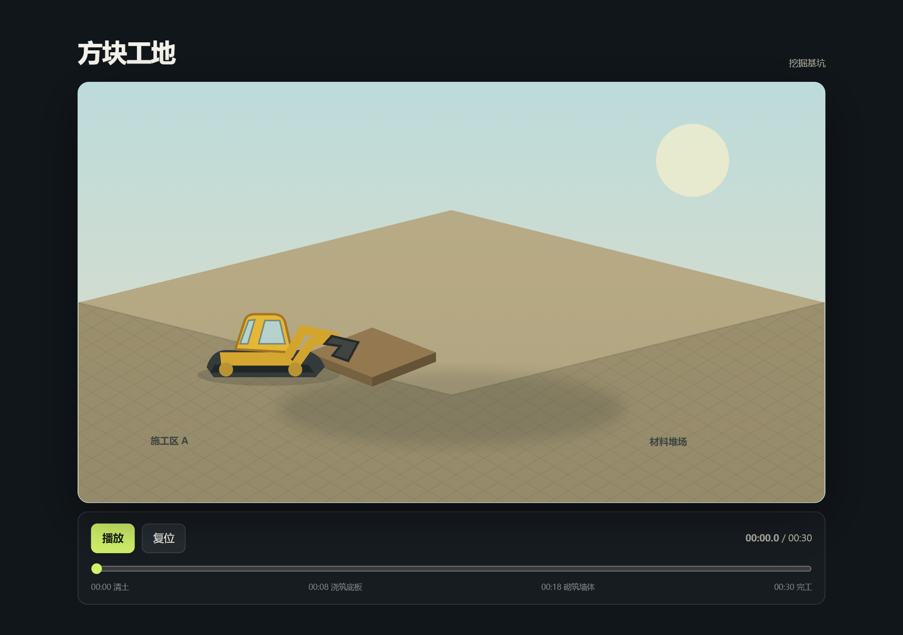

# 砼序 · 工地调度台

> **Construction Dispatch 3D** —— 一个工地施工过程的三维交互演示：土方开挖 → 混凝土浇筑 → 砖墙砌筑，用一条可拖动的时间轴把 60 秒工序完整回放。纯前端，浏览器打开即用。

仓库包含两版实现：

| 版本 | 说明 |
| --- | --- |
| `claude-mvp/` | 轻量 Demo，单个 HTML 文件、纯 SVG 绘制，用来快速验证交互 |
| `codex-mvp/` | 完整版，Three.js 三维调度台，功能齐全 |

## 功能

- **三维场景**：5 类工程车辆（搅拌车、挖掘机、叉车、龙门吊、配送车）+ 5 个作业站点
- **确定性时间线**：任意时刻的状态完全由时间决定，拖动进度条可精确回放
- **实时指标**：土方、混凝土、砖墙、运行设备随时间同步刷新
- **点选与搜索**：点击场景中的设备即可聚焦查看详情
- **碰撞检测**：全时段扫描车辆与设施，输出碰撞时间段
- **视频导出**：在浏览器内直出 720p / 60fps 演示视频

## 快速开始

**Demo 版**（无需依赖）：直接用浏览器打开 `claude-mvp/index.html`。

**完整版**（需要依赖 + 静态服务器）：

```bash
cd codex-mvp
npm install
python -m http.server 8080
```

然后访问 <http://localhost:8080/>。

> 视频导出需要较新的 Chrome / Edge。

## 交互

拖动时间轴回放；点击设备查看详情；拖动旋转、滚轮缩放、右键平移视角；顶部搜索框可按名称/编号查找。

## 技术栈

原生 JavaScript（ES Modules）、[Three.js](https://threejs.org/) 0.187、[mediabunny](https://mediabunny.dev/) + WebCodecs（视频导出）。无框架、无打包。

> 本项目仅含公开依赖，无密钥、无个人路径，仅保留压缩后的演示视频。详见 `.gitignore`。

## 演示

### 完整版 · Three.js 三维调度台




### Demo 版 · 单文件 SVG




### 演示视频

**[▶ 观看完整演示视频（60 秒 · 720p）](asset/demo-3d.mp4)**
