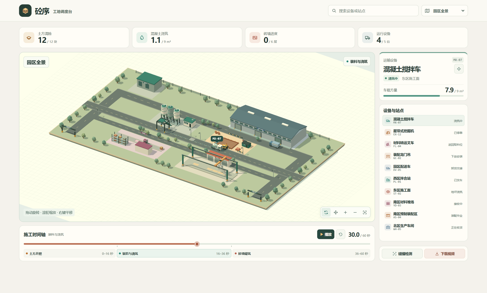
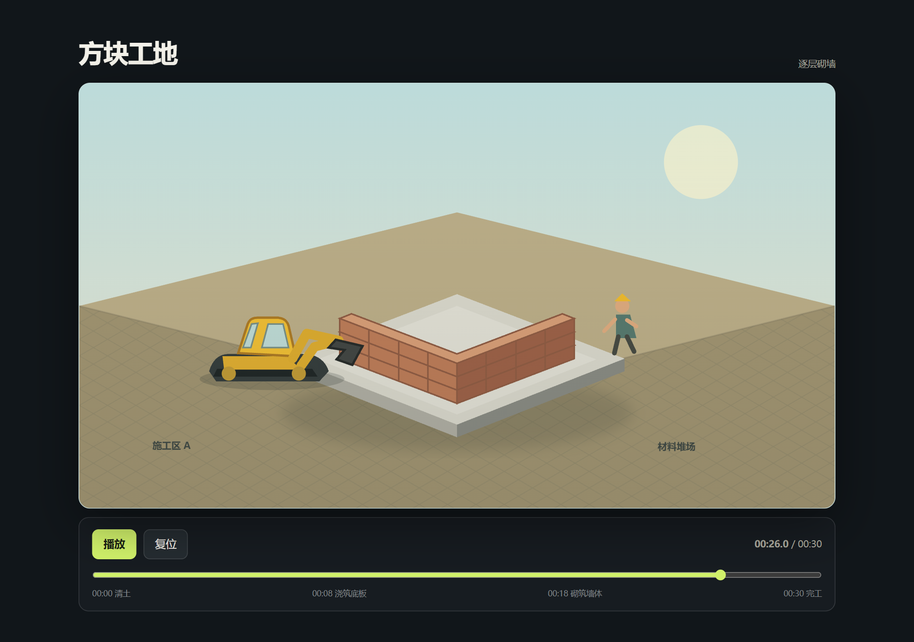

# 砼序 · 工地调度台

> 一个「工地施工全过程」的三维交互演示：从土方开挖、混凝土浇筑到砖墙砌筑，用可拖拽的时间轴把 60 秒工序完整可视化。

本仓库记录同一套工地演示的 **两版实现**：先用 `claude-mvp` 做轻量 Demo 验证交互与节奏，再用 `codex-mvp` 落地为完整的 Three.js 三维调度台。两者共享同一套施工时间线与场景叙事，方便直观对比「快速原型」与「完整产品」的差异。

- **纯前端**：无需后端、无需构建，浏览器打开即用
- **零依赖（Demo 版）**：单个 HTML 文件即可运行
- **三维引擎（完整版）**：Three.js 正交相机 + 程序化建模
- **可导出**：完整版支持在浏览器内直出 1280×720 / 60fps 演示视频

---

## 目录

- [项目背景](#项目背景)
- [两种实现对比](#两种实现对比)
- [功能特性](#功能特性)
- [技术栈](#技术栈)
- [目录结构](#目录结构)
- [快速开始](#快速开始)
- [交互指南](#交互指南)
- [实现细节](#实现细节)
- [浏览器兼容性](#浏览器兼容性)
- [安全与脱敏说明](#安全与脱敏说明)
- [许可证](#许可证)
- [演示](#演示)

---

## 项目背景

一个住宅/园区工地在 60 秒内会同时发生很多事：挖掘机清土、搅拌车进场浇筑、叉车转运托盘、龙门吊吊装预制构件、配送车绕场送货、砖墙逐层砌筑……

把这条「施工流水线」压缩进一个可拖动、可回放的交互界面，既适合做 **施工可视化大屏** 的原型，也适合作为 **Three.js 程序化建模** 与 **确定性仿真** 的教学样例。

仓库里的两版实现：

| 版本 | 定位 | 关键词 |
| --- | --- | --- |
| `claude-mvp/` | **Demo / 交互验证** | 单文件、纯 SVG、等轴投影（isometric） |
| `codex-mvp/` | **完全体 / 三维调度台** | Three.js、确定性仿真、碰撞检测、视频导出 |

---

## 两种实现对比

| 维度 | `claude-mvp`（Demo 版） | `codex-mvp`（完整版） |
| --- | --- | --- |
| 渲染方式 | 手写 SVG 图标 + CSS | Three.js WebGL 三维场景 |
| 相机 | 固定等轴视角 | 正交相机，可旋转/平移/缩放 |
| 文件规模 | 1 个 HTML 文件（约 500 行） | 4 个 JS 模块（约 1900 行） |
| 依赖 | 无 | `three` + `mediabunny` |
| 施工时长 | 30 秒 | 60 秒 |
| 施工阶段 | 清土 → 浇筑底板 → 砌墙 | 土方开挖 → 装料与浇筑 → 砖墙砌筑 |
| 实体 | 挖掘机 / 搅拌车 / 工人 | 5 类车辆 + 5 个站点 |
| 交互 | 播放 / 暂停 / 复位 / 拖动 | 播放、拖动、点选、搜索、相机控制 |
| 碰撞检测 | 无 | 有（0.1s 采样 + 分离轴定理） |
| 视频导出 | 无 | 有（WebCodecs，720p/60fps） |
| 适用场景 | 快速演示、截图、教学 | 调度大屏、完整产品原型 |

---

## 功能特性

### 完整版 `codex-mvp`

- **确定性施工时间线**：`stateAt(t)` 是一个纯函数 —— 任意时刻的施工状态完全由时间决定，拖动进度条可精确复现任意一帧。
- **5 类工程车辆 + 5 个作业站点**：混凝土搅拌车（MX-07）、履带式挖掘机（EX-12）、材料转运叉车（FL-04）、装配龙门吊（GC-02）、园区配送车（DV-05），以及拌合站、施工面、堆场、装配区、生产车间。
- **实时指标面板**：土方清除块数、混凝土浇筑方量、砖墙层数、运行设备台数，随时间轴同步刷新。
- **点选定位 + 搜索**：点击三维场景中的设备/站点即可选中并自动聚焦；顶部搜索框支持按名称/编号/类型模糊匹配，支持方向键与回车。
- **相机控制**：旋转 / 平移 / 放大 / 缩小 / 重置，兼容鼠标与触屏手势。
- **碰撞检测**：每 0.1 秒对车辆包围盒与固定设施做分离轴（SAT）扫描，输出碰撞时间段，并区分「正常作业接触」（铲斗挖土）。
- **浏览器内视频导出**：基于 WebCodecs 逐帧渲染并编码，优先 H.264（MP4），回退 VP8（WebM），带进度条与取消。
- **无障碍与响应式**：ARIA 语义、键盘导航、桌面/平板/手机多断点布局。

### Demo 版 `claude-mvp`

- **单文件零依赖**：一个 `index.html` 内含全部 SVG、CSS 与脚本，双击即开。
- **等轴方块风**：用几何化的 SVG 图形还原挖掘机、搅拌车、工人与砖墙，风格统一、加载极快。
- **30 秒施工回放**：播放 / 暂停 / 复位 / 任意拖动，四段式进度刻度直观展示工序。

---

## 技术栈

- **运行时**：原生 JavaScript（ES Modules），无框架、无打包
- **三维**：[Three.js](https://threejs.org/) `0.187.0`
  - `OrthographicCamera` 正交投影，保证等轴视觉
  - `OrbitControls` 相机交互
  - 程序化几何体建模（`BoxGeometry` / `CylinderGeometry` / `LatheGeometry` / `ShapeGeometry` …）
  - `Raycaster` 点选拾取
- **视频编码**：[mediabunny](https://mediabunny.dev/) `1.66.1` + 浏览器原生 WebCodecs
- **样式**：原生 CSS（自定义属性、`color-mix`、容器查询式断点）
- **静态服务器**：任意静态文件服务（开发时用 `python -m http.server`）

---

## 目录结构

```text
X_ganme/
├── README.md                 # 本文件
├── .gitignore
├── asset/
│   ├── demo-3d.mp4           # 压缩后的演示视频（约 2 MB）
│   └── screenshots/          # README 截图
│       ├── claude-mvp-01.png
│       ├── claude-mvp-02.png
│       ├── codex-mvp-01.png
│       ├── codex-mvp-02.png
│       └── codex-mvp-03.png
├── claude-mvp/               # Demo 版：单文件 SVG 等轴动画
│   └── index.html
└── codex-mvp/                # 完整版：Three.js 三维调度台
    ├── index.html            # 页面骨架 + importmap
    ├── app.js                # 应用入口：UI 绑定、相机、事件、导出
    ├── simulation.js         # 确定性仿真：状态计算、碰撞扫描
    ├── world.js              # 三维世界：建模、材质、渲染、拾取
    ├── export-video.js       # 浏览器内视频编码
    ├── styles.css            # 完整版样式
    ├── package.json
    └── package-lock.json
```

> `node_modules/` 与原始录屏不入库，见 `.gitignore`。

---

## 快速开始

### Demo 版（零依赖）

直接用浏览器打开 `claude-mvp/index.html` 即可。

```bash
open claude-mvp/index.html      # macOS
start claude-mvp\index.html     # Windows
```

### 完整版（需要依赖）

完整版通过 [importmap](https://developer.mozilla.org/docs/Web/HTML/Element/script/type/importmap) 直接加载 `node_modules` 下的 ESM，因此需要一个静态服务器（不能用 `file://` 打开）。

```bash
cd codex-mvp
npm install

# 任选一个静态服务器，在仓库根目录或 codex-mvp 目录启动均可
python -m http.server 8080
# 或：npx serve .
```

然后访问 <http://localhost:8080/codex-mvp/>（若在 `codex-mvp/` 目录启动则访问 <http://localhost:8080/>）。

> 提示：视频导出功能依赖 WebCodecs，请使用较新版本的 Chrome / Edge。

---

## 交互指南

| 操作 | 说明 |
| --- | --- |
| 播放 / 暂停 | 点击「播放」按钮，或拖动时间轴 |
| 拖动时间轴 | 精确定位到任意时刻（0.1 秒步进） |
| 点击阶段 | 快速跳转到「土方开挖 / 装料与浇筑 / 砖墙砌筑」起点 |
| 点击设备 | 在三维场景中点选车辆/站点，右侧详情随之切换 |
| 搜索 | 输入名称、编号或类型，支持 ↑/↓ 选择、回车确认、Esc 关闭 |
| 相机 | 拖动旋转、滚轮缩放、右键平移；也可用底部按钮切换模式 |
| 碰撞检测 | 打开弹窗查看全时段碰撞结果，点击时间段可跳转 |
| 下载视频 | 在浏览器内逐帧渲染并导出 60 秒三维全景视频 |

---

## 实现细节

### 1. 确定性仿真

完整版把「时间 → 状态」抽象成一个纯函数 `stateAt(t)`（见 `codex-mvp/simulation.js`）。所有车辆位置、机械臂姿态、物料进度都由时间推导，因此：

- 拖动进度条、导出视频、碰撞扫描，得到的都是同一套结果；
- 无随机数、无状态累积，天然可复现。

施工被切分为三段，并与原时间线保持几何与节奏比例：

```text
0s ──────── 16s ──────── 36s ──────────── 60s
  土方开挖      装料与浇筑      砖墙砌筑
```

### 2. 程序化建模

`world.js` 用基础几何体拼装工地：料仓（圆柱）、装料斗（四棱锥）、龙门吊（箱体 + 轨道）、预制构件（带缝隙的板材）、搅拌车（车体 + 旋转滚筒 + 溜槽）、挖掘机（履带 + 驾驶室 + 两段式机械臂 + 铲斗）……

材质统一走颜色缓存（`materialCache`），避免重复创建导致的内存与绘制开销。

### 3. 碰撞检测

- 以 **0.1 秒** 为间隔采样整条时间线（共 441 个采样点）；
- 用**分离轴定理（SAT）** 检测带旋转的有向包围盒（OBB）是否相交；
- 智能合并连续采样，输出「碰撞对象 / 障碍物 / 起止时刻」；
- 区分「正常作业接触」：铲斗与作业土方接触计为正常挖掘，不计入异常。

### 4. 浏览器内视频导出

`export-video.js` 借助 `mediabunny` 的 `CanvasSource` 与浏览器 WebCodecs：

- 逐帧调用 `renderFrame(frame / 60)` 驱动场景，保证编码速度不影响播放时序；
- 每 2 秒插入关键帧，便于拖动与回放；
- 自动选择 `avc`（MP4）或回退 `vp8`（WebM）；
- 支持进度回调与 `AbortSignal` 取消。

---

## 浏览器兼容性

| 功能 | 要求 |
| --- | --- |
| 三维场景 | 支持 WebGL 2 的现代浏览器 |
| 视频导出 | 支持 WebCodecs 的 Chrome / Edge（较新版本） |
| Demo 版 | 任何现代浏览器（纯 SVG/CSS） |

若浏览器未启用 WebGL，完整版会在画布上给出提示而不是白屏。

---

## 安全与脱敏说明

本仓库已做信息脱敏处理，可放心公开：

- **无密钥/令牌**：代码中不含任何 API Key、Token、账号口令或私有地址；
- **无个人路径**：未硬编码本机绝对路径、用户名或邮箱；
- **无隐私画面**：演示视频为纯三维场景录制，不含桌面、任务栏、聊天或个人信息；
- **依赖来源公开**：所有第三方依赖均来自 npm 公共源；
- **原始素材不入库**：仅保留压缩后的 `asset/demo-3d.mp4`，原始录屏已通过 `.gitignore` 排除。

如你 fork 后补充自己的素材，请同样在提交前检查是否包含敏感信息。

---

## 许可证

本项目仅用于学习、教学与技术演示，未经授权请勿用于商业用途。第三方库遵循其各自许可证（Three.js — MIT；mediabunny — 见其仓库）。

---

## 演示

### 完整版 · 工地调度台（Three.js）




> 5 类车辆 + 5 个作业站点、实时指标、可拖拽时间轴、点选定位与碰撞检测。

### Demo 版 · 方块工地（单文件 SVG）




### 演示视频

**[▶ 观看完整演示视频（60 秒 · 720p）](asset/demo-3d.mp4)**

<sub>视频为 `codex-mvp` 完整版的三维场景录制，已压缩至约 2 MB 以便在 GitHub 中流畅播放。</sub>
